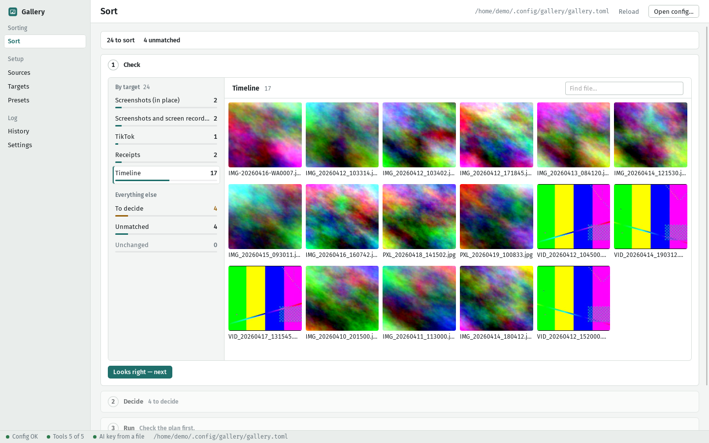
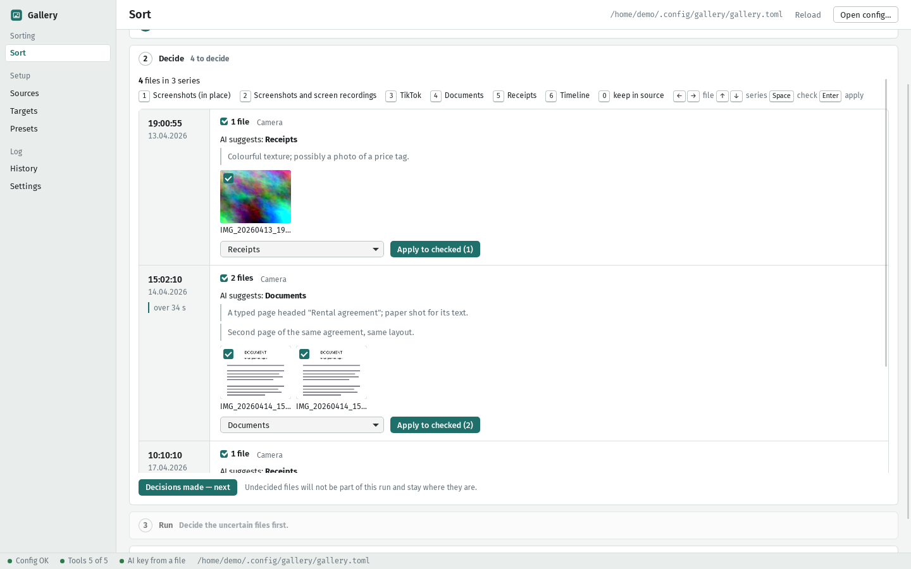
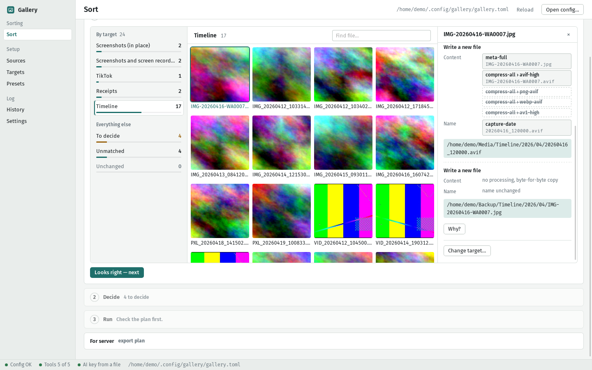
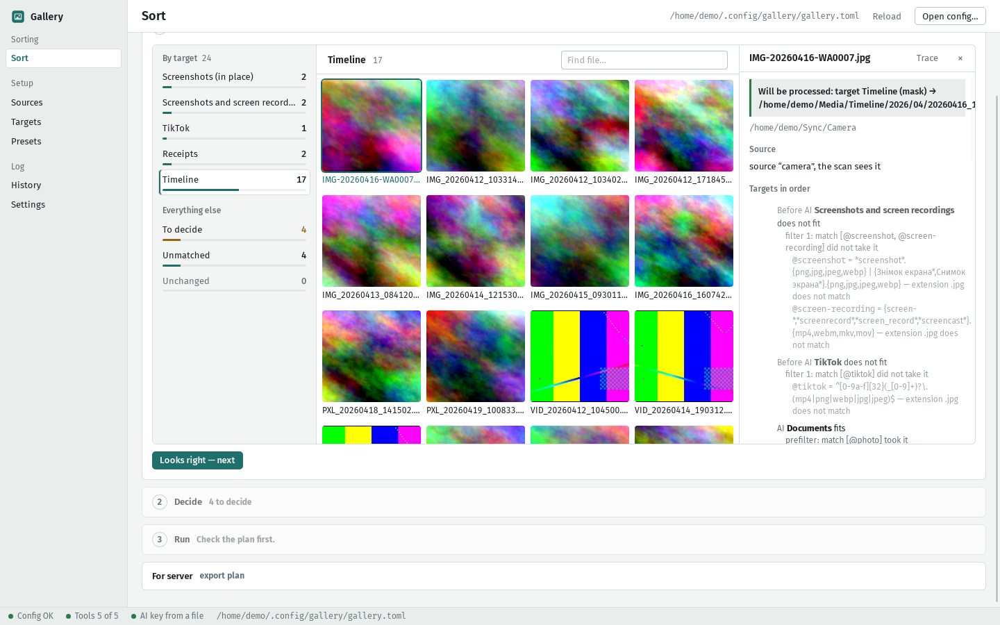
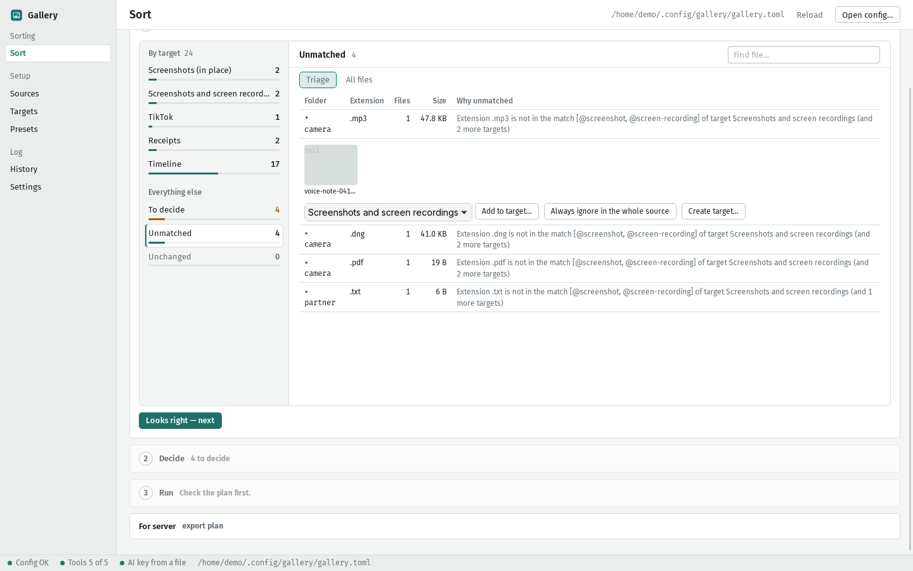
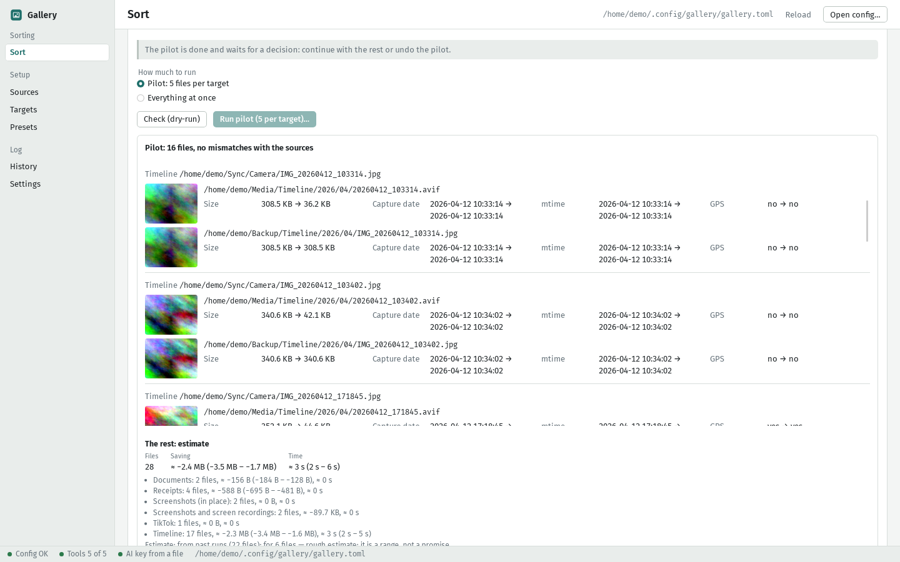
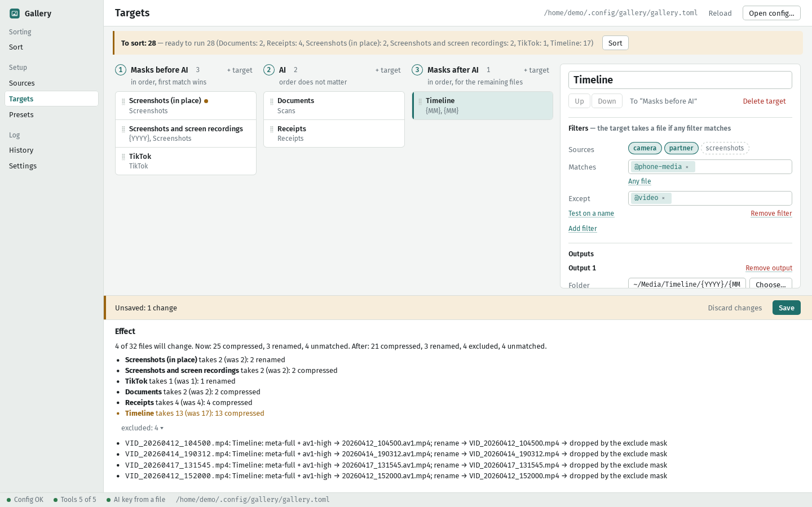
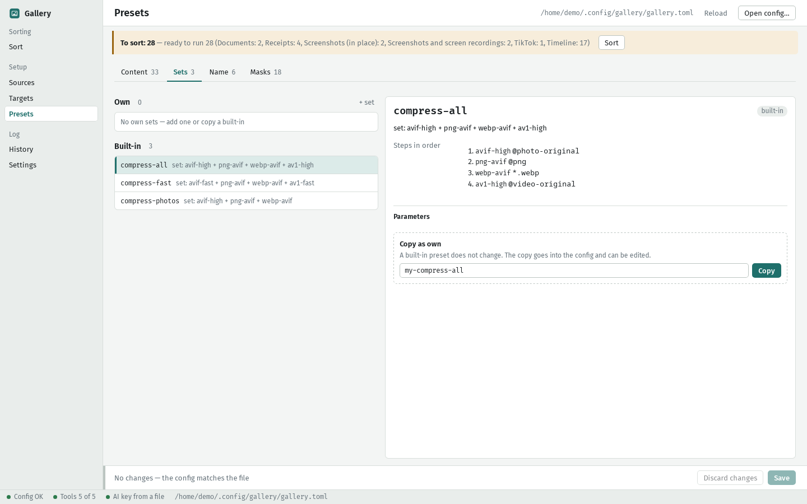
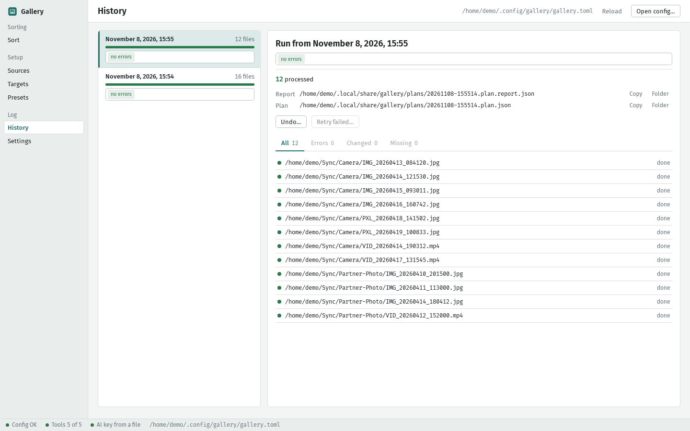

# Gallery

**Gallery sorts the photos and videos that pile up in your sync folders.** Point it at your
sources (a phone camera folder, a partner's folder, a screenshots folder…), describe where each kind
of file belongs, and Gallery walks every file down **one ordered list of targets**. A target's filter
is built from conditions: name masks, dates, places, neighbouring files, duplicates, series, and, for
the fuzzy cases ("is this a receipt or a document?"), **one Claude request per file**. The first
matching target takes the file. Gallery shows you the whole plan, and only then does the work: metadata fixes, AVIF / WebP / AV1 / Opus
compression, capture-date names and folders, backups. Your originals are never overwritten; they go
to the trash only after every output is written **and verified**, and every run can be undone.

It is a desktop app (Tauri v2: Rust core + React UI) and a command-line tool built on the same core.



> **Status:** a personal project, published as-is. Linux is the home platform; Windows and macOS
> builds are new and CI-tested, but less used. Releases carry unsigned bundles (see below), or you
> build from source. The config format and file layout may still change. It works on my libraries; try it on a copy of yours first (the pilot run
> and undo are there for exactly that).

## Contents

- [Highlights](#highlights)
- [Safety model](#safety-model)
- [Install](#install)
- [Quick start](#quick-start)
- [AI setup](#ai-setup)
- [Server workflow](#server-workflow)
- [CLI reference](#cli-reference)
- [Languages](#languages)
- [Documentation](#documentation) · [License](#license)

## Highlights

**One flow: Check → Decide → Run.** The Sort screen always shows one *current plan*, kept up to date
as files and config change (without spending a cent on AI). Check what goes where, decide the
doubtful files, run.

| | |
|---|---|
|  **Decide** — the AI's unsure answers, grouped into series of shots taken together, plus series to review (pick the best shot) and last copies held back from the trash; accept or change them with the keyboard. Your corrections are remembered and shown to the AI next time. |  **Trace** — for any file: its content pipe step by step (`meta-full`, then which `compress-all` step fired) and where each output will land. |
|  **"Why?"** — why a file went to this target and not another: every filter, mask and `!` exclusion, what the AI said, and a one-line verdict. Also `gallery explain`. |  **Unmatched triage** — files no target takes, grouped by folder and extension, with the reason and one-click fixes: add to a target, ignore in the source, or create a target. |
|  **Pilot run** — apply a few files per target first and compare before → after: size, capture date, mtime, GPS. Continue with the rest or undo the pilot. |  **Targets editor with live effect** — change a mask and see, before saving, how many of your real files move between targets. |
|  **Presets** — built-in encoders and *bundles* such as `compress-all` (AVIF for photos, PNG and WebP; AV1 for video) with one-click copy-and-edit. |  **History** — every run with its report; undo a run, or retry only the files that failed. |

More in the app: a cost **estimate** before a run (space saved or added, time, AI cost), **Syncthing
pause** while a run is being checked, a **tray icon** with notifications when new files are waiting,
and **export of a plan for a server**. There is also a dark theme
([screenshot](docs/screenshots/sort-dark.png)).

What the plan can do for each target, per output folder:

- **Content pipe:** metadata fixes (capture date, Google Camera tags, time-zone offset, video GPS),
  AVIF / WebP photo encoders, SVT-AV1 + Opus video, Opus / MP3 / AAC / FLAC audio, lossless
  `optipng`, with a quality ladder that keeps the original bytes when a re-encode would not be smaller.
- **Rename pipe:** capture-date names (`20260412_103314.avif`), `year/month` folders, your own
  templates.
- **Ordered targets** instead of fixed stages: one list, the first matching target takes a file.
  A target can place files into folders (`folders`), send them to the trash (`trash`) or protect them
  from the targets below (`keep`).
- **Rich filters:** capture date and time of day, places (`geo`, with named points), events and
  neighbouring files across sources (`near`, `expand = "event"`: photos taken together by two
  phones), device, file properties (size, codecs, blur score), duplicates, burst series (with a
  side-by-side best-shot review), folders (`path`) and the AI as one more condition. A scan never
  trashes the last copy of a group of duplicates or of a series.
- **Named masks** with `@refs` and `!` exclusions (`["@photo", "!@edited"]`) and built-ins for screenshots,
  WhatsApp, TikTok, camera-phone names, RAW and more.

## Safety model

Gallery is built so that a bad config or a bad encode costs you a few minutes, not photos.

- **Nothing is overwritten.** Outputs are staged under `.gallery-tmp-*` and placed with a
  no-overwrite rename; a name that is taken gets `_1`, `_2`…
- **Originals go to the trash only after verification.** Each result is compared with its source
  (capture date, mtime, GPS, dimensions, duration) *before* it is placed. A mismatch means the
  result is not placed and the source stays where it is. The source is trashed only after **all** of
  its outputs exist.
- **You run exactly the plan you confirmed.** If files, config or decisions changed since the
  check, the run is refused and the plan is rebuilt for you to review again. Files that changed
  after the scan are skipped.
- **Pilot first.** Try N files per target and inspect before → after before continuing.
- **Undo and retry.** Every run writes a report; undo restores the sources from the trash and
  removes only the outputs still identical to what was written. A per-file journal is synced as the
  run goes, so even a crash or power cut leaves undo with the full picture.
- **Locks.** One apply/undo per machine at a time (GUI and CLI share the lock), one lock per plan,
  one GUI instance.
- **Syncthing pause (optional).** Hold back sync of the folders a run touches until you have looked.
- **The AI sees a thumbnail, not your library.** One 512 px preview per photo (three 400 px frames
  for a video) plus your category text. No file names, no originals. The AI is only called when you
  press *Ask AI* in the app or run `gallery scan`, and you can see the cost estimate first.

Details: [docs/architecture.md](docs/architecture.md#safety-guarantees).

## Install

### Requirements (Linux)

| For | Needed |
|---|---|
| GUI | `webkit2gtk-4.1`, `libsoup-3`, GTK 3, `libayatana-appindicator` (tray icon) — see Tauri's [Linux prerequisites](https://v2.tauri.app/start/prerequisites/#linux) |
| Media work | `ffmpeg` built with **`libsvtav1`** and **`libopus`** (`libvidstab` for `av1-action-cam`), `ffprobe`, `exiftool`, `avifenc` (libavif), **ImageMagick 7** (`magick`), `optipng` (PNG presets only) |
| Build | Rust (edition 2024, so a recent stable), Node.js and [pnpm](https://pnpm.io) |

For example, on Arch: `pacman -S webkit2gtk-4.1 libsoup3 libayatana-appindicator ffmpeg perl-image-exiftool libavif imagemagick optipng`. On Debian/Ubuntu the equivalents are
`libwebkit2gtk-4.1-dev libsoup-3.0-dev libayatana-appindicator3-dev ffmpeg libimage-exiftool-perl libavif-bin imagemagick optipng`
(check that your `ffmpeg` has `libsvtav1`: `gallery check` tells you).

### Build from source

```sh
git clone https://github.com/grigorii-horos/gallery
cd gallery

pnpm install                       # front end + the Tauri CLI
pnpm tauri build --no-bundle       # the app: target/release/gallery-gui
cargo build --release -p gallery-cli   # the CLI: target/release/gallery
```

Copy `gallery-gui` and `gallery` somewhere on your `PATH`. `gallery install-desktop` adds
`gallery-gui` to your application menu. Then check your tools:

```sh
gallery check
```

### Windows and macOS

Tagged releases (`v*`) attach a draft GitHub Release with the GUI bundles (Linux AppImage/deb,
Windows msi/nsis, macOS dmg for Apple Silicon and Intel) and the `gallery` CLI. **They are not
code-signed**: on macOS right-click the app and choose *Open* the first time (or run
`xattr -dr com.apple.quarantine /Applications/Gallery.app`); on Windows SmartScreen shows
*More info → Run anyway*.

The external tools are not bundled. Install them with a package manager:

| | Windows | macOS (Homebrew) |
|---|---|---|
| ffmpeg + ffprobe (needs `libsvtav1`, `libopus`) | `winget install Gyan.FFmpeg` | `brew install ffmpeg` |
| exiftool | `winget install OliverBetz.ExifTool` | `brew install exiftool` |
| ImageMagick 7 (`magick`) | `winget install ImageMagick.ImageMagick` | `brew install imagemagick` |
| avifenc (libavif) | `scoop install libavif` | `brew install libavif` |
| optipng (PNG presets only) | `scoop install optipng` | `brew install optipng` |

Tools are looked up in `GALLERY_TOOLS_DIR`, then in a `tools` folder next to the executable (drop
the `.exe` files there for a self-contained install), then on `PATH`. `gallery check` lists what is
missing together with the command for your system.

Differences from Linux: the app-menu entry (`gallery install-desktop`) and "Launch at login" are
Linux-only (use the system's own settings elsewhere); files go to the Recycle Bin / Trash, and
undo restores them automatically on Windows, while on macOS you put them back from the Trash by
hand (the OS offers no listing API). Dates are computed by Gallery itself (zone rules from the
plan), so results do not depend on the OS time-zone handling. Syncthing's `config.xml` is found in
`%LOCALAPPDATA%\Syncthing` or `~/Library/Application Support/Syncthing`.

## Quick start

### 1. A minimal config

Create `~/.config/gallery/gallery.toml` (the app's default location):

```toml
[[sources]]
id = "camera"
path = "~/Sync/Camera"

[[targets]]
name = "Timeline"

[[targets.filters]]
sources = ["camera"]
match = ["@photo", "@video"]

# Processed copy: fix metadata, then compress photos (AVIF), PNGs and videos (AV1).
[[targets.outputs]]
dir = "~/Media/Timeline/{YYYY}/{MM}"
content = ["meta-full", "compress-all"]
rename = ["capture-date"]

# Backup: a byte-for-byte copy.
[[targets.outputs]]
dir = "~/Backup/Timeline/{YYYY}/{MM}"
```

This takes every photo and video from the camera folder, writes a compressed copy named by capture
date into `Media/Timeline/<year>/<month>` and a byte-for-byte backup, then trashes the original.
Everything else is left alone and listed as *unmatched*. The full reference is
[docs/configuration.md](docs/configuration.md); [`examples/gallery.toml`](examples/gallery.toml) is a
bigger example with screenshots, AI categories and per-source prompts.

Targets are an ordered list: the first target whose filter matches takes the file. A bigger taste:

```toml
[[targets]]                       # copies of the same file go to the trash (never the last copy)
name = "Duplicates"
kind = "trash"
[[targets.filters]]
sources = ["camera", "partner"]
duplicate = { of = ["sources", "outputs"] }

[[targets]]                       # photos taken together with the partner's phone (and the rest of that event)
name = "Together"
[[targets.filters]]
sources = ["camera"]
near = { sources = ["partner"], time = "2h", km = 1 }
expand = "event"
[[targets.outputs]]
dir = "~/Sync/Shared/{YYYY}"
```

### 2. First run in the GUI

1. Start `gallery-gui`. The status bar at the bottom shows *Config OK* and *Tools 5 of 5*.
2. **Sort → Check.** Pick a target on the left and look at the thumbnails. Click a file to see its
   trace (every step and the final path) and **Why?** to see why it went there. Fix the config in
   **Sources / Targets / Presets** (the editor shows the effect of an unsaved change on your real
   files) and press **Reload**.
3. **Decide** (only if there is something to decide: unsure AI answers, series to review, or last
   copies held back from the trash): apply a category to each series of shots, pick the best shot of
   a series, and decide where a held copy goes.
4. **Run.** Read the estimate, pick **Pilot** (5 files per target) and run it, compare before → after,
   then **Continue with the rest**. Something wrong? **Undo pilot**, or later **History → Undo**.

### 3. The same on the command line

```sh
gallery scan -c ~/.config/gallery/gallery.toml -o plan.json   # summary: per target, review, unmatched
gallery apply plan.json --dry-run                             # nothing written, prints an estimate
gallery apply plan.json --pilot 5                             # a few files per target first
gallery apply plan-rest.plan.json -j 8                        # then the rest
gallery undo plan-pilot.plan.report.json                      # if the pilot looked wrong
```

`gallery explain -c gallery.toml <file>` answers "why wasn't this file processed?", and
`gallery unmatched -c gallery.toml` lists what no target takes.

## AI setup

The AI is optional: unless some filter has an `ai` condition, Gallery never contacts Anthropic.

1. **Key.** Set `ANTHROPIC_API_KEY` (or `CLAUDE_API_KEY`), or put the key in
   `~/.config/gallery/api-key` and make it owner-only (`chmod 600`; a key file readable by others is
   ignored with a warning). An app started from the application menu may not inherit your shell's
   environment, so the key file is the dependable choice for the GUI.
2. **Categories.** A filter with an `ai` condition makes its target a category; the target name is the
   category and `ai` is its description. The model chooses one category or "none".
   ```toml
   [[targets]]
   name = "Receipts"
   [[targets.filters]]
   sources = ["camera"]
   match = "@photo"              # only photos are sent at all
   ai = "Photos of receipts, invoices and price tags."
   [[targets.outputs]]
   dir = "~/Documents/Receipts"
   rename = ["capture-date"]
   ```
3. **Per-source prompt.** Frame the category list for a source with `ai_prefix` (before the list) and
   `ai_suffix` (after it), inline or from files (`ai_prefix_file`, `ai_suffix_file`):
   ```toml
   [[sources]]
   id = "camera"
   path = "~/Sync/Camera"
   ai_prefix = "These are phone shots: family, trips, paperwork. Most are ordinary photos."
   ai_suffix = "A person in the frame is never a document, even holding a paper."
   ```
4. **Language and model.**
   ```toml
   [ai]
   model = "claude-sonnet-5-5"   # default
   effort = "low"                # default
   language = "ru"               # language of the model's short reasons (name or code); unset = the interface language
   examples = 20                 # your latest corrections shown to the AI; 0 turns learning off
   ```
5. **Cost.** Answers are cached per file, model and prompt, so each file is asked about once.
   - GUI: **Sort** shows *Ask AI (N files, ≈ $X)*; asking for more than about a dollar needs an
     extra confirmation. The app never calls the AI on its own.
   - CLI: `gallery scan -c gallery.toml --estimate` prints the estimate (files to send, files cached)
     without any call. `gallery scan` itself asks for every uncached file.
6. **Learning.** When you change an AI answer, the correction is stored as text and shown to the AI as
   an example for the same source. `gallery examples list|clear`, or Settings → AI examples.

## Server workflow

Plan on the desktop (where the AI and your decisions live), apply on the machine that holds the files.

1. Give sources a `server_path` and outputs a `server_dir` in the config (the same folders as the
   server sees them):
   ```toml
   [[sources]]
   id = "camera"
   path = "~/Sync/Camera"
   server_path = "/srv/sync/camera"

   [[targets.outputs]]
   dir = "~/Media/Timeline/{YYYY}/{MM}"
   server_dir = "/srv/media/Timeline/{YYYY}/{MM}"
   ```
2. On the desktop, export the plan: in the app, **Sort → For server → export plan** (choose a folder
   Syncthing syncs), or `gallery scan --server -c gallery.toml -o plan.json`.
3. On the server: `gallery apply plan.json` (add `GALLERY_TRASH=folder` if the server has no desktop
   trash). The plan carries its own presets, so the server needs only the `gallery` binary and the
   external tools, not your config. The server's `gallery` must be at least as new as the desktop's.
4. `plan.report.json` appears next to the plan and returns through Syncthing; the GUI's History reads
   it, and `gallery undo plan.report.json` works wherever the files are reachable.

## CLI reference

| Command | Purpose |
|---|---|
| `gallery check [-c CONFIG]` | Tools, versions, capabilities; with `-c` also validates the config |
| `gallery presets` | Built-in presets, bundles and masks |
| `gallery scan -c CONFIG -o PLAN [--server] [--accept-low] [--no-ai] [--overrides FILE]` | Scan → plan + summary |
| `gallery scan -c CONFIG --estimate` | AI cost estimate only |
| `gallery apply PLAN [--dry-run] [-j N] [--pilot N] [--allow-anomalies] [--pause-sync]` | Execute a plan; writes `PLAN.report.json` |
| `gallery undo REPORT` | Roll a run back |
| `gallery explain -c CONFIG FILE…` | Why a file gets the treatment it gets |
| `gallery unmatched -c CONFIG [--plan PLAN]` | Triage of files no target takes |
| `gallery pending -c CONFIG [--json]` | How many files wait (for scripts and cron) |
| `gallery sync status` / `resume` | Syncthing folders Gallery paused |
| `gallery examples list` / `clear [--source ID]` | The AI's learned corrections |
| `gallery install-desktop [--exe PATH]` | Application-menu entry for the GUI |

Exit codes: `0` ok · `1` error (for `check`: a required tool is missing) · `2` an `apply` item failed
or the run stopped on discrepancies · `130` stopped with Ctrl-C. Full reference with every flag:
[docs/cli.md](docs/cli.md).

## Languages

The GUI and the command line speak eleven languages: English (the source and the fallback),
Русский, Українська, Deutsch, Français, Español, Português (Brasil), Italiano, Polski, Română and 简体中文.

- **GUI:** *Settings → Language* lists the eleven by their own names, plus *System*. The choice
  applies at once, with no restart: the interface, the messages from the core, the tray menu and
  the notifications. It is stored in the GUI's `settings.json`. *System* (the default) follows the
  operating system's language and falls back to English.
- **CLI:** `gallery --lang ru presets` (global flag), else `LC_ALL`, `LC_MESSAGES`, `LANG`, else
  English. `--help` and the output are translated; the first line of `gallery pending` stays
  `pending: N` in every language, and `--json` output is never translated.
- **Matching:** the exact language first (`uk_UA` → Ukrainian, `ru_UA` → Russian), then the one
  regional variant there is (`pt_PT` → Brazilian Portuguese, `zh_TW` → Simplified Chinese);
  anything else is English.
- **AI reasons:** when `[ai] language` is not set, the model writes its short reasons in the
  interface language (the CLI's or the GUI's); an explicit `language` always wins.
- **Not translated:** preset and mask names, config keys, file paths and log lines.
  Screenshots stay in English.

Translations live in `locales/<lang>.json` (messages of the Rust crates) and
`ui/src/i18n/locales/<lang>.json` (the interface). Tests fail if a language lacks a key, has an
extra one, uses other placeholders than English or lacks a plural form its language needs.

## Documentation

- [docs/configuration.md](docs/configuration.md) — every config key, masks, presets and bundles
  (built-in tables), name templates, the `[ai]` section.
- [docs/cli.md](docs/cli.md) — every command and flag, with examples.
- [docs/architecture.md](docs/architecture.md) — crates, data flow, files on disk, safety guarantees.
- [`examples/gallery.toml`](examples/gallery.toml) — a complete, commented configuration.

## Development

```sh
cargo test --workspace            # tests needing external tools skip themselves when they are missing
cargo clippy --workspace --all-targets -- -D warnings
pnpm -C ui typecheck && pnpm -C ui lint && pnpm -C ui test
```

Run the GUI in development with `pnpm tauri dev`. Debug builds honour `GALLERY_DATA_DIR` to keep
state away from your real data; release builds ignore it.

## License

[MIT](LICENSE) © 2026 Grigorii Horos
